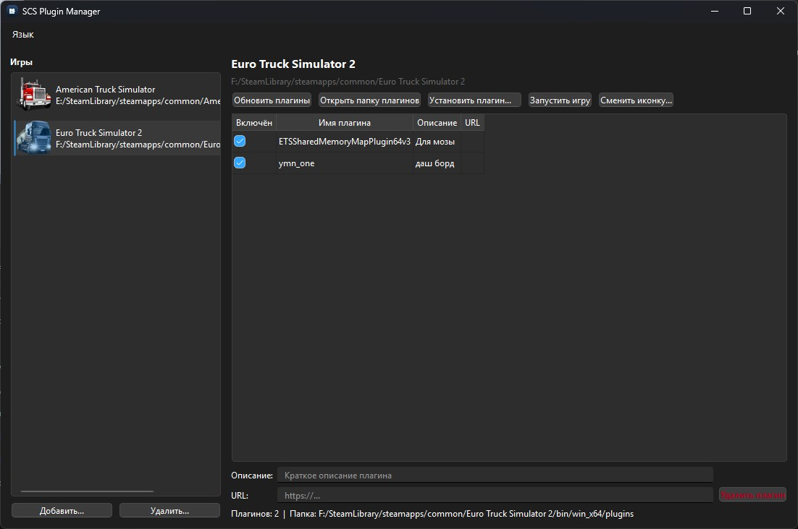

# SCS Plugin Manager

**[🇷🇺 Русский](#ru) · [🇬🇧 English](#en)**

---

## 🇷🇺 Русский

Менеджер плагинов для **Euro Truck Simulator 2** и **American Truck Simulator**. Утилита находит установленные игры (в том числе через Steam), показывает список DLL-плагинов в папке `bin\win_x64\plugins` и позволяет включать, отключать, устанавливать и удалять их без ручного переименования файлов.

### Возможности

- 🔍 **Автопоиск игр в Steam** — ETS2 (App ID 227300) и ATS (App ID 270880). Поиск проходит по всем библиотекам Steam через `libraryfolders.vdf`, а путь к игре определяется из `appmanifest_<id>.acf`.
- 📁 **Ручное добавление игры** — если игра установлена не через Steam, укажите корневую папку вручную. Путь сохраняется в базе данных.
- ✅ **Включение и отключение плагинов** одним кликом. Включённый плагин — файл `plugin.dll`, отключённый — `plugin.dll.disable`. Никаких внешних утилит.
- 📦 **Установка плагинов** из трёх источников:
  - ZIP-архив (с вложенной папкой или файлами в корне — оба варианта поддерживаются);
  - отдельные файлы;
  - папка целиком (рекурсивно, со всеми подкаталогами).
- 🗑️ **Полное удаление плагина** вместе со всеми его вспомогательными файлами (конфиги, ресурсы, helper-DLL), зарегистрированными при установке. Файлы, общие с другими плагинами, не удаляются.
- 📝 **Описание и ссылка на источник** для каждого плагина — хранятся в БД.
- 🖼️ **Иконки игр** извлекаются из `.exe` автоматически; можно задать свою.
- 🌐 **Русский и английский интерфейс** с переключением из меню.
- 💾 **SQLite-база** хранит игры, плагины, метаданные и списки вспомогательных файлов. Путь: `%APPDATA%\SCS\SCSPLuginManager\`.

### Использование

1. При первом запуске программа пытается найти ETS2 и ATS через Steam. Если не нашла — нажмите **«Добавить...»** и укажите корневую папку игры (ту, где лежит `bin\win_x64`).
2. В левой панели выберите игру. В правой появится список плагинов.
3. **Чекбокс** включает/отключает плагин. **Двойной клик** по строке открывает описание и URL.
4. Кнопка **«Установить плагин...»** — меню из трёх вариантов: файлы, ZIP, папка.
5. Кнопка **«Удалить плагин»** — удаляет файл (и все его вспомогательные файлы) после подтверждения.
6. Кнопка **«Открыть папку плагинов»** — открывает `plugins` выбранной игры в Проводнике.

### Лицензия

Проект распространяется под лицензией **Apache License 2.0**. Полный текст — в файле [LICENSE](LICENSE).

Использует **Qt 6.8** (LGPLv3) — динамическая линковка, см. [лицензию Qt](https://www.qt.io/licensing).

---

## 🇬🇧 English

Plugin manager for **Euro Truck Simulator 2** and **American Truck Simulator**. The app auto-detects installed games (including Steam libraries), lists DLL plugins from the `bin\win_x64\plugins` folder, and lets you enable, disable, install, and remove them — no more manual file renaming.

### Features

- 🔍 **Steam auto-detection** for ETS2 (App ID 227300) and ATS (App ID 270880). Scans all Steam libraries via `libraryfolders.vdf` and resolves the game path from `appmanifest_<id>.acf`.
- 📁 **Manual game addition** — pick the game's root folder if it was installed outside Steam. The path is stored in the database.
- ✅ **One-click enable/disable**. An enabled plugin is `plugin.dll`, a disabled one is `plugin.dll.disable`. No third-party tools needed.
- 📦 **Plugin installation** from three sources:
  - ZIP archive (with or without a top-level folder — both handled);
  - individual files;
  - a whole folder (recursive, including subdirectories).
- 🗑️ **Full removal** of a plugin along with all its auxiliary files (configs, resources, helper DLLs) recorded during installation. Files shared with other plugins are preserved.
- 📝 **Description and source URL** for each plugin, stored in the database.
- 🖼️ **Game icons** extracted from `.exe` automatically; custom icons supported.
- 🌐 **Russian and English UI** with a menu switcher.
- 💾 **SQLite database** keeps games, plugins, metadata, and auxiliary file lists. Located at `%APPDATA%\SCS\SCSPLuginManager\`.

### Usage

1. On first launch, the app tries to locate ETS2 and ATS via Steam. If nothing is found, click **"Add..."** and pick the game's root folder (the one containing `bin\win_x64`).
2. Select a game in the left panel — its plugins appear on the right.
3. The **checkbox** toggles a plugin. **Double-click** a row to edit its description and URL.
4. The **"Install plugin..."** button opens a menu with three options: files, ZIP, folder.
5. The **"Delete plugin"** button removes the file (plus all auxiliary files) after confirmation.
6. The **"Open plugins folder"** button opens the selected game's `plugins` directory in Explorer.

### License

Distributed under the **Apache License 2.0**. Full text in the [LICENSE](LICENSE) file.

Uses **Qt 6.8** (LGPLv3) — dynamically linked, see the [Qt license](https://www.qt.io/licensing).
